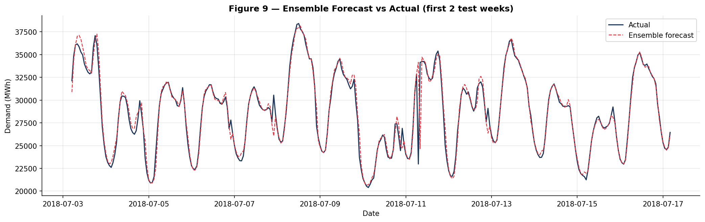
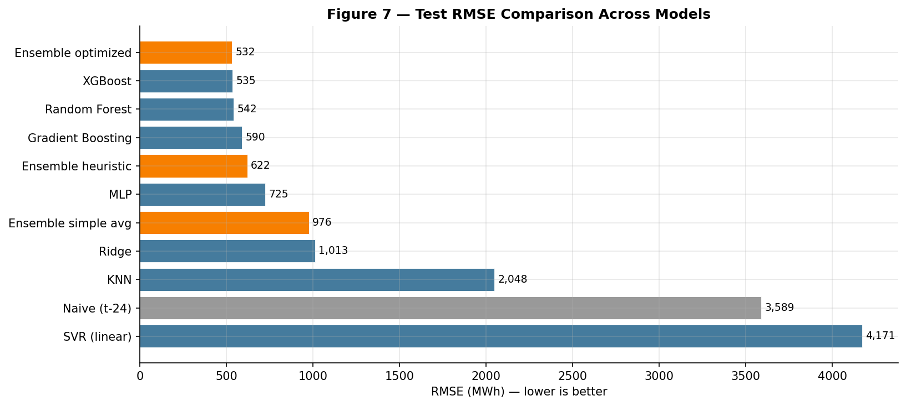

# Spanish Electricity Demand Forecasting with a Heterogeneous Ensemble

An academic team project investigating whether a heterogeneous ensemble can improve hour-ahead electricity-demand forecasts for Spain.



## Overview

Accurate short-term electricity-demand forecasts help system operators balance supply and demand, schedule generation and manage system reliability. This project compares several statistical and machine-learning models under a chronological evaluation design and combines their predictions in an optimised weighted ensemble.

The project uses hourly Spanish energy-system data and weather observations from 2015 to 2018. The prediction target is **total electricity load**, measured in MWh.

## Research question

Can a weighted ensemble of diverse forecasting models outperform its individual components when predicting Spanish hourly electricity demand?

## Data

- **Period:** 2015–2018
- **Frequency:** hourly
- **Energy observations:** 35,064 hours
- **Inputs:** historical electricity load, calendar variables, lagged features and weather observations
- **Weather coverage:** five Spanish cities
- **Target:** total load actual (MWh)

The two source files come from the Kaggle dataset [Hourly energy demand, generation and weather](https://www.kaggle.com/datasets/nicholasjhana/energy-consumption-generation-prices-and-weather). Raw data are not committed to this repository; see [`data/README.md`](data/README.md) for download and placement instructions.

## Models

The analysis compares a seasonal naive benchmark with seven individual models:

1. Ridge regression
2. K-nearest neighbours
3. Linear support vector regression
4. Random forest
5. Gradient boosting
6. XGBoost
7. Multilayer perceptron

An additional ensemble chooses non-negative model weights by minimising validation error.

## Evaluation

The data are divided chronologically to avoid using future observations to predict the past. Performance is evaluated using RMSE, MAE, MAPE and R².

### Main results

| Model | Test RMSE (MWh) | Test MAE (MWh) | Test MAPE | Test R² |
|---|---:|---:|---:|---:|
| Optimised ensemble | **528.18** | 351.34 | 1.22% | **0.9868** |
| Random forest | 531.58 | **348.36** | **1.20%** | 0.9867 |
| XGBoost | 545.38 | 372.42 | 1.29% | 0.9860 |
| Gradient boosting | 577.27 | 402.52 | 1.39% | 0.9843 |
| Heuristic ensemble | 608.13 | 419.73 | 1.45% | 0.9825 |
| MLP | 711.96 | 512.90 | 1.81% | 0.9761 |
| Simple-average ensemble | 938.63 | 696.89 | 2.31% | 0.9584 |
| Ridge regression | 1,018.70 | 761.93 | 2.64% | 0.9510 |
| KNN | 2,093.54 | 1,504.66 | 5.27% | 0.7930 |
| Seasonal naive (t−24) | 3,590.51 | 2,520.34 | 8.75% | 0.3912 |
| Linear SVR | 4,020.96 | 3,412.31 | 10.99% | 0.2365 |

The ensemble produced the lowest test RMSE, although its improvement over random forest was modest. This should therefore be interpreted as an incremental forecasting gain rather than evidence that ensembling always dominates a strong individual learner. Random forest achieved slightly better MAE and MAPE, illustrating that the preferred model depends on the operational loss function.



## Repository structure

```text
.
├── README.md
├── requirements.txt
├── .gitignore
├── notebooks/
│   └── electricity_demand_forecasting.ipynb
├── reports/
│   └── figures/
├── results/
│   └── results_table.csv
└── data/
    └── README.md
```

The notebook contains the complete course-project workflow. A future version may refactor repeated operations into reusable modules, but the current release prioritises transparency and fidelity to the submitted analysis.

## Reproducibility

After downloading the two source files, the workflow is:

```bash
python -m venv .venv
source .venv/bin/activate
pip install -r requirements.txt
jupyter lab
```

Open `notebooks/electricity_demand_forecasting.ipynb` and run the cells from top to bottom. The notebook expects both CSV files in `data/raw/`.

## Limitations

- The analysis covers a single country and historical period.
- Weather observations from five cities may not fully represent national conditions.
- Hyperparameter selection is constrained by the computational scope of a course project.
- Performance should be reassessed on more recent data and under rolling-origin validation.
- The ensemble's gain over random forest is small and may not persist in a different period.

## Team and attribution

Developed as a Machine Learning course project by:

- Didac Bustamante
- Nil Castaño
- Taiki Causton
- Joan Garcia Almenara

This was a collaborative course project. Individual contributions will be described once they have been confirmed with the team.

The data-cleaning and exploratory structure was informed by Dimitrios Roussis's Kaggle notebook [Electricity price forecasting with DNNs (+ EDA)](https://www.kaggle.com/code/dimitriosroussis/electricity-price-forecasting-with-dnns-eda), released under the Apache 2.0 licence. This project changes the target from electricity price to electricity demand and uses a distinct modelling and ensemble strategy. See [`ATTRIBUTION.md`](ATTRIBUTION.md).

## Status

This repository is being prepared for public release. Team approval and individual contribution statements are still pending.

